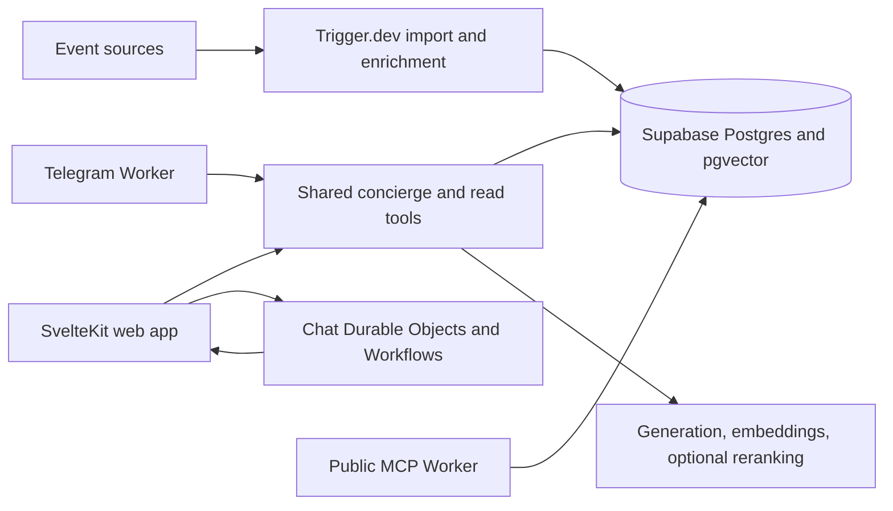

# Architecture overview

BA Eventos keeps catalog ingestion, recommendation reasoning, and user-facing delivery separate.

## Code map

| Directory | Responsibility |
| --- | --- |
| `src/routes/` | Pages, authenticated routes, and HTTP boundaries |
| `src/features/chat/` | Concierge orchestration, read tools, canonical responses, conversation UI |
| `src/features/events/` | Catalog reads, cards, artwork delivery, and saved-event presentation |
| `src/features/auth/` | Sessions, admission controls, and account operations |
| `src/features/import/` | Source acquisition, parsing, normalization, enrichment, and provenance |
| `src/trigger/jobs/` | Background import and maintenance jobs |
| `src/chat-delivery-worker/` | Durable web delivery and recovery |
| `src/telegram-worker/` | Telegram webhook and inbox handling |
| `src/mcp-worker/` | Public event-discovery MCP interface |
| `src/shared/` | Database clients, AI providers, security helpers, shared types and UI |
| `supabase/` | Historical schema, migrations, SQL checks, and seed examples |
| `evals/` | Deterministic fixtures and opt-in provider-backed evaluations |
| `.storybook/` | Isolated UI fixture environment |
| `openspec/specs/` | Expected behavior and channel contracts |

## Boundaries worth reading

The concierge consumes untrusted user text and catalog content. It can call read tools; the server constructs cards and links from validated results. Model prose still needs quality evaluation. See [chat trust boundary](chat-trust-boundary.md) and [canonical response](canonical-response.md).

User saves and account operations have separate authenticated boundaries. Supabase service-role access is server-only. The public MCP surface must expose catalog data without leaking user conversations or internal records.

Cloudflare runs the web, Telegram, MCP, and durable-delivery Workers. Trigger.dev owns background import jobs. Their credentials and release processes are separate; see [Workers Builds](cloudflare-workers-builds.md).

Historical decisions and migration records describe earlier implementations as well as the current system. Prefer current source, specifications, and [development instructions](development.md) when a historical note disagrees.
