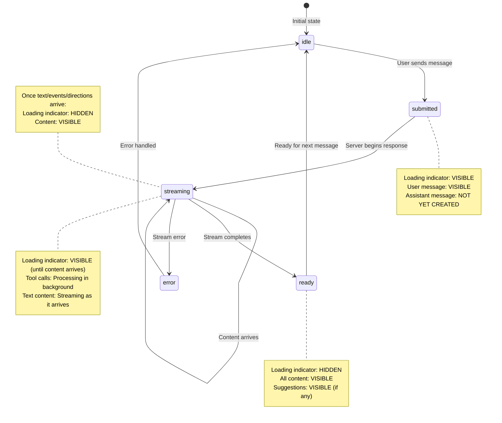

# Chat Streaming State Machine

This document describes the streaming state machine for the AI chat feature, documenting how the UI responds to different states during a chat interaction.

## State Machine Diagram



## Status Values

The `useChat` hook from `@ai-sdk/react` provides a `status` value:

| Status | Description | UI State |
|--------|-------------|----------|
| `'ready'` | Idle, waiting for user input | Input enabled, no loading |
| `'submitted'` | Message sent, waiting for server | Loading indicator visible |
| `'streaming'` | Receiving streamed response | Loading visible until content arrives |
| `'error'` | An error occurred | Error state, input re-enabled |

## Loading Indicator Logic

The loading indicator ("Thinking...") visibility is controlled by `showLoading`:

```typescript
const showLoading = status === 'submitted' || (status === 'streaming' && !hasVisibleAssistantContent)
```

This means the loading indicator shows when:
1. **Status is `'submitted'`**: Waiting for the server to start responding
2. **Status is `'streaming'` but no visible content**: Claude is executing tool calls (e.g., `search_events`) but hasn't produced text, events, or directions yet

The loading indicator hides as soon as ANY of these appear:
- Text content (streamed response)
- Events (from `data-events` custom data)
- Directions (from `data-directions` custom data)

## Message Filtering

Empty assistant messages are filtered out to prevent showing just timestamps:

```typescript
const displayMessages = chatMessages.filter(m => {
  if (m.role === 'user') return true
  const hasVisibleContent = m.content.trim().length > 0 ||
                           (m.events && m.events.length > 0) ||
                           m.directions
  return hasVisibleContent || m.isStreaming
})
```

## Data Flow

```
┌─────────────────┐     POST /api/chat      ┌─────────────────┐
│   ChatContainer │ ──────────────────────► │   API Route     │
│   (useChat)     │                         │   (streamText)  │
└────────┬────────┘                         └────────┬────────┘
         │                                           │
         │  ◄─────── UIMessageStream ───────────────┤
         │           (text chunks)                   │
         │                                           │
         │  ◄─────── data-events ───────────────────┤
         │           (accumulated events)            │
         │                                           │
         │  ◄─────── data-suggestions ──────────────┤
         │           (refinement chips)              │
         │                                           │
         │  ◄─────── data-directions ───────────────┤
         │           (maps link data)                │
         ▼                                           │
┌─────────────────┐                         ┌────────┴────────┐
│   MessageList   │                         │   Tool Calls    │
│   (renders)     │                         │   (onStepFinish)│
└─────────────────┘                         └─────────────────┘
```

## Custom Data Parts

The server sends custom data alongside the streamed text using `writer.write()`:

| Type | Data | When Sent |
|------|------|-----------|
| `data-events` | `EventWithVenue[]` | After stream completes, if events found |
| `data-suggestions` | `RefinementSuggestion[]` | After stream completes, if search was performed |
| `data-directions` | `DirectionsData` | After stream completes, if directions requested |

These are handled in the `onData` callback of `useChat`:

```typescript
onData: (dataPart) => {
  if (dataPart.type === 'data-events') {
    setEvents(dataPart.data as EventWithVenue[])
  } else if (dataPart.type === 'data-suggestions') {
    setSuggestions(dataPart.data as RefinementSuggestion[])
  } else if (dataPart.type === 'data-directions') {
    setDirections(dataPart.data as DirectionsData)
  }
}
```

## Timeline Example

A typical "Find techno events tonight" interaction:

```
Time    Status      Loading     Visible Content
─────   ──────────  ─────────   ───────────────────────────────
0ms     ready       hidden      (empty chat)

10ms    submitted   VISIBLE     User message: "Find techno..."

200ms   streaming   VISIBLE     (model thinking / calling search_events)

800ms   streaming   hidden      Reasoning text streams (muted), then the
                                guarded answer types as 24-char text-deltas.

2000ms  ready       hidden      Text + Events + Suggestions
```

Reasoning is streamed live via `reasoning-*` chunks plus `data-status.reasoning`.
The finished answer is still assembled and guarded first, then emitted as
`text-delta` chunks so the bubble types instead of appearing all at once.

## Related Files

- `src/routes/-components/chat/ChatContainer.tsx` - Main chat state management
- `src/routes/-components/chat/MessageList.tsx` - Message rendering + loading indicator
- `src/routes/-components/chat/ChatMessage.tsx` - Individual message rendering
- `src/routes/api/chat.ts` - Server-side streaming handler
